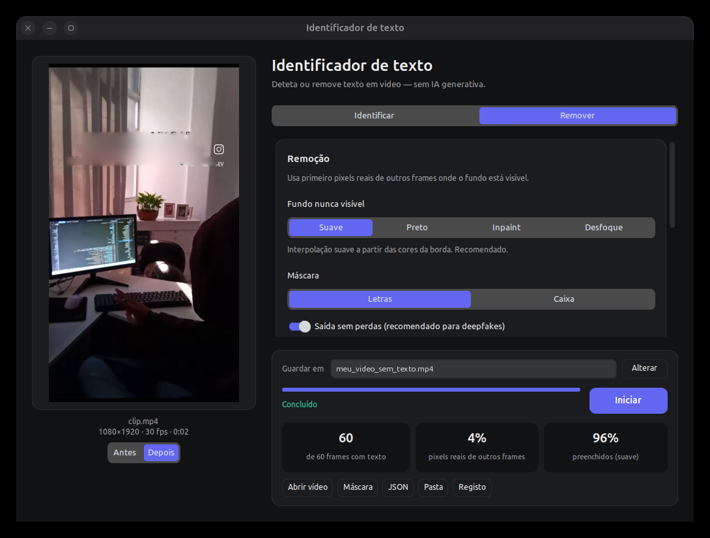
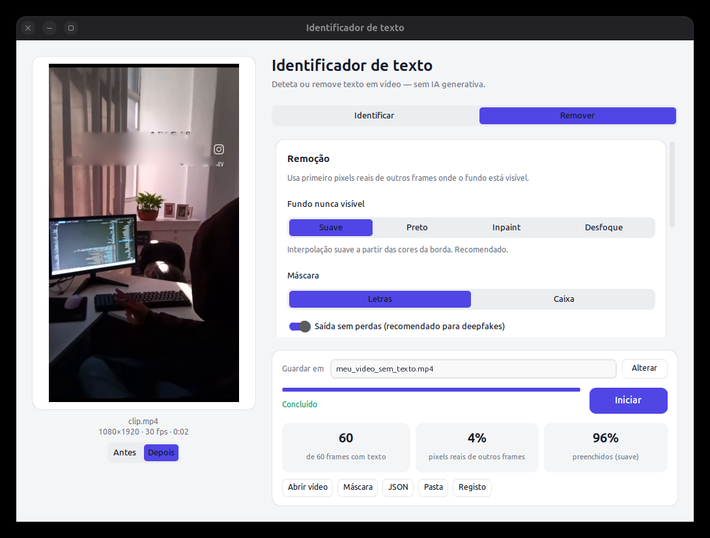

<div align="center">

# 🔎 Identificador de Texto em Vídeo

**Detecta, lê e remove texto de vídeos — sem IA generativa.**

Pensado como pré-processamento para **detecção de deepfakes**: tira legendas, marcas d'água e
sobreposições sem inserir pixels sintéticos que confundam o detector.




</div>

---

## ✨ O que ele faz

| | Modo | Resultado |
|---|---|---|
| 🟩 | **Identificar** | Desenha *bounding boxes* em volta de todo texto legível, com o texto lido e a confiança. Gera também um JSON com frame, tempo, caixas e texto. |
| 🧽 | **Remover** | Apaga o texto usando **pixels reais de outros frames** onde o fundo aparece. Só o que nunca fica visível é preenchido por um método clássico, ou fica preto. |

**Destaques**

- 🖥️ **Interface gráfica** com pré-visualização antes/depois, barra de progresso com tempo restante e estatísticas no final.
- ⚡ **Roda em CPU**: modelos PP-OCR em ONNX, sem PyTorch nem GPU.
- 🎯 **Máscara justa às letras**, e não à caixa inteira: altera o mínimo possível de pixels.
- 🎞️ **Preenchimento temporal** com alinhamento de câmera (ORB + homografia) e validação em volta de cada bloco.
- 🔒 **Saída sem perdas** (`libx264rgb qp 0`) e **áudio original copiado** sem recodificar.
- 🗺️ **Vídeo de máscara** opcional, que mostra exatamente quais pixels foram alterados e como.

---

## 📥 Como baixar

### 1. Pré-requisitos

- **Python 3.10+**, com Tkinter (já vem no Python do Windows e do macOS)
- **FFmpeg**: recomendado. Sem ele, o vídeo sai sem áudio e com qualidade inferior.

<details>
<summary><b>Instalar os pré-requisitos por sistema</b></summary>

**Ubuntu / Debian**
```bash
sudo apt install python3 python3-venv python3-tk ffmpeg git
```

**Fedora**
```bash
sudo dnf install python3 python3-tkinter ffmpeg git
```

**macOS** (Homebrew)
```bash
brew install python python-tk ffmpeg git
```

**Windows**: instale o [Python](https://www.python.org/downloads/) (marque *Add to PATH*), o
[Git](https://git-scm.com/download/win) e o FFmpeg (`winget install ffmpeg`).
</details>

### 2. Clonar e instalar

```bash
git clone https://github.com/<seu-usuario>/Identificador-de-texto.git
cd Identificador-de-texto

python3 -m venv .venv
.venv/bin/pip install -r requirements.txt        # Windows: .venv\Scripts\pip install -r requirements.txt
```

> Na primeira execução, o RapidOCR baixa automaticamente os modelos de OCR (alguns MB).

---

## 🚀 Como usar

### Pela interface gráfica (recomendado)

```bash
.venv/bin/python gui.py                           # Windows: .venv\Scripts\python gui.py
```

1. **Clique na área de pré-visualização** e escolha o vídeo.
2. Escolha o modo: **Identificar** ou **Remover**.
3. Ajuste as opções, se quiser. As opções finas ficam em **Avançado**.
4. Clique em **Iniciar**. No final, alterne entre **Antes / Depois** e abra o vídeo, a máscara, o JSON ou a pasta.

<div align="center">

<br><sub>A interface acompanha o tema claro/escuro do sistema.</sub>
</div>

### Pela linha de comando

```bash
# Identificar texto (bounding boxes)
.venv/bin/python detectar_texto.py video.mp4
.venv/bin/python detectar_texto.py video.mp4 --a-cada 5        # analisa 1 a cada 5 frames (mais rápido)
.venv/bin/python detectar_texto.py video.mp4 --min-conf 0.7    # mais exigente
.venv/bin/python detectar_texto.py video.mp4 --so-detecao      # só caixas, sem ler o texto

# Remover texto (pré-processamento para deepfakes)
.venv/bin/python detectar_texto.py video.mp4 --remover suave --sem-perdas --salvar-mascara
```

### Arquivos gerados

| Modo | Arquivos |
|---|---|
| Identificar | `video_texto.mp4` · `video_texto.json` |
| Remover | `video_sem_texto.mp4` · `video_sem_texto.json` · `video_sem_texto_mascara.mp4` (opcional) |

No JSON de remoção, `pct_pixels_reais_de_outros_frames` e `pct_pixels_fallback` informam quanto
do texto foi substituído por fundo real e quanto teve de ser preenchido.

<details>
<summary><b>Todas as opções da linha de comando</b></summary>

| Opção | Padrão | Descrição |
|---|---|---|
| `-o, --saida` | `<nome>_texto.mp4` / `<nome>_sem_texto.mp4` | Vídeo de saída |
| `--json` | `<saida>.json` | Arquivo de resultados |
| `--a-cada N` | `1` | Analisa 1 a cada N frames; os outros reutilizam as caixas |
| `--min-conf` | `0.5` | Confiança mínima do OCR para aceitar uma caixa |
| `--so-detecao` | — | Só detecção (sem leitura): mais rápido, mais falsos positivos |
| `--remover MODO` | — | `suave`, `preencher`, `inpaint` ou `borrar` (veja abaixo) |
| `--mascara` | `letras` | `letras` (só os pixels do texto) ou `caixa` (a caixa inteira) |
| `--margem` | `3` | Pixels extras em volta das letras |
| `--janela` | `30` | Frames para trás e para frente onde procurar o fundo real (`0` desliga) |
| `--limiar-temporal` | `6` | Diferença máxima aceita em volta de um bloco copiado (menor = mais rigoroso) |
| `--persistir` | `3` | Mantém as caixas por até N frames quando o detector falha |
| `--salvar-mascara` | — | Grava o vídeo da máscara (sem perdas) |
| `--sem-perdas` | — | Saída `libx264rgb qp 0` (arquivo grande, pixels idênticos) |
| `--mostrar` | — | Mostra o vídeo numa janela durante o processamento |
</details>

---

## 🧠 Como funciona

```
 frame ─► Detecção (DBNet) ─► Reconhecimento (SVTR/CRNN) ─► filtra por confiança
                                                                   │
                         ┌───────────── Identificar ◄──────────────┤
                         ▼                                         ▼
                desenha as caixas                              Remover
                                                                   │
              1. máscara justa às letras (cor do texto vs. fundo em volta)
              2. pixels REAIS de frames vizinhos (alinhados e validados)
              3. o que sobrar ─► suave · preto · inpaint · desfoque
```

### Remoção sem pixels sintéticos

1. **Máscara justa às letras.** As cores do texto são as que aparecem muito mais dentro das
   caixas do que em volta delas. A máscara inclui também o contorno/sombra e os pequenos buracos
   entre as letras.
2. **Pixels reais de outros frames.** O programa procura até `--janela` frames para trás e para
   frente onde o fundo esteja visível. Os frames são alinhados pelo movimento da câmera, e um
   bloco só é copiado se a vizinhança coincidir com o frame atual.
3. **O resto** (fundo que nunca aparece, como uma legenda parada o vídeo todo) vai para o modo
   escolhido:

| Modo | O que faz | Quando usar |
|---|---|---|
| `suave` | Interpolação harmônica (Laplace) a partir das cores da borda | **Recomendado.** Sem facetas nem riscos |
| `preencher` | Preto sólido | **Nenhum pixel inventado**: o detector pode ignorar essas zonas |
| `inpaint` | Inpainting clássico Telea (OpenCV) | Pode deixar facetas em áreas grandes |
| `borrar` | Desfoque gaussiano | Só esconde; pode deixar um "fantasma" do texto |

**Máscara gravada:** ⬛ preto = original · ◻️ cinza = pixel real vindo de outro frame ·
⬜ branco = preenchido pelo modo acima.

### 🎭 Cuidados para detecção de deepfakes

- **Não** use inpainting generativo (LaMa, ProPainter…): ele introduz pixels sintéticos, exatamente o que o detector procura.
- Recomprimir altera os rastros de compressão: use `--sem-perdas`.
- Aplique **o mesmo** pré-processamento a vídeos reais e falsos. Do contrário, o modelo aprende "processado vs. não processado".
- Ao remover, analise todos os frames (`--a-cada 1`). A GUI já força isso.
- Onde o fundo nunca aparece não existe informação real. Sobre texturas (barba, cortinas) a interpolação continua visível; nesses casos, prefira `preencher` ou ignore as zonas brancas da máscara.

---

## 🔬 Por que PP-OCR?

| Modelo | Detecção | Reconhecimento | Observações |
|---|---|---|---|
| **PP-OCR (PaddleOCR) via RapidOCR** | DBNet | SVTR/CRNN | ✅ **Escolhido.** ONNX, roda bem em CPU, multilíngue, instalação simples |
| EasyOCR | CRAFT | CRNN | Bom, mas exige PyTorch (pesado e lento em CPU) |
| OpenCV EAST / DB | EAST/DB | — | Só detecção, não confirma se o texto é legível |
| Tesseract | fraco em cenas | LSTM | Feito para documentos; ruim com texto em vídeo |
| docTR | DBNet/LinkNet | CRNN/ViTSTR | Boa qualidade, porém mais pesado |

---

## 📁 Estrutura

```
Identificador-de-texto/
├── gui.py               # interface gráfica (CustomTkinter)
├── detectar_texto.py    # motor: detecção, OCR e remoção (CLI)
├── requirements.txt
├── docs/                # imagens do README
└── .gitignore           # vídeos e resultados ficam fora do repositório
```

> 🎬 **Vídeos não são versionados.** O `.gitignore` bloqueia todos os formatos de vídeo e os
> JSONs gerados. Coloque os seus vídeos na pasta do projeto à vontade: eles não vão para o Git.
